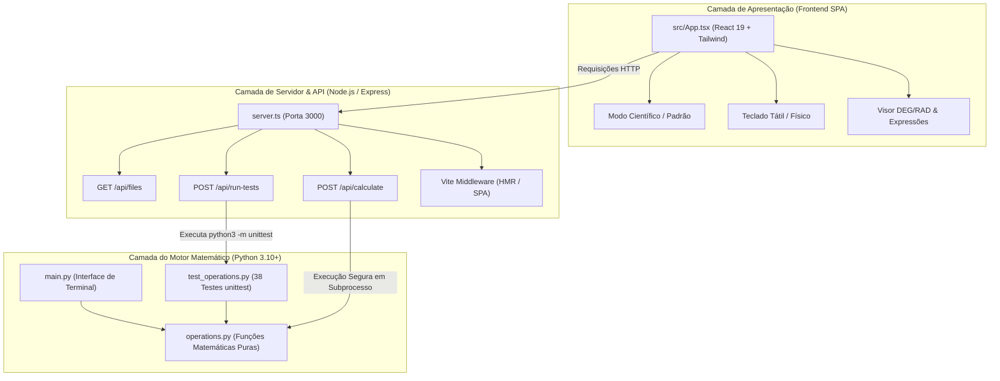

# Calculadora Científica em Python & Interface Web Avançada

Calculadora Científica completa desenvolvida em **Python 3.10+** e acompanhada de uma **Interface Web Moderna (React + Tailwind CSS + Lucide Icons + Vite)**, proporcionando alta fidelidade matemática, excelente experiência de usuário (UX/UI) e cobertura rigorosa de testes unitários com o framework nativo `unittest`.

O projeto foi construído seguindo as convenções **PEP 8**, boas práticas de desenvolvimento modular, validações defensivas contra falhas de domínio numérico e zero dependências externas no núcleo de cálculo em Python (apenas a biblioteca padrão `math`).

---

## 1. Destaques e Funcionalidades

### 1.1. Operações Aritméticas e Especiais
- **Quatro Operações Básicas**: Adição (`+`), Subtração (`-`), Multiplicação (`*`) e Divisão (`/`).
- **Resto da Divisão (Módulo)**: Operador `%` para divisões inteiras e reais.
- **Valor Absoluto (Módulo)**: `|x|` para magnitudes reais.
- **Inverso Multiplicativo**: `1/x` com proteção contra divisão por zero.
- **Porcentagem**: `%` com suporte a cálculo relativo e fracionário.
- **Fatorial**: `n!` para inteiros não-negativos com validação de limite contra estouro de memória.

### 1.2. Potenciação e Radiciação
- **Potenciação Arbitrária**: $x^y$ com suporte a bases e expoentes reais (positivos, nulos e negativos).
- **Potências Rápidas**: $x^2$ (quadrado), $x^3$ (cubo).
- **Bases Especiais**: $10^x$ e $e^x$ ($\exp$).
- **Radiciação**:
  - $\sqrt{x}$ (raiz quadrada) com bloqueio preventivo para $x < 0$ no domínio dos reais.
  - $\sqrt[3]{x}$ (raiz cúbica) com suporte total a números negativos (ex: $\sqrt[3]{-8} = -2$).
  - $\sqrt[y]{x}$ (raiz $n$-ésima) com validação de índice e paridade.

### 1.3. Logaritmos
- **Logaritmo na Base 10**: $\log_{10}(x)$ com validação de $x > 0$.
- **Logaritmo Natural**: $\ln(x)$ (base $e$) com validação de $x > 0$.
- **Logaritmo na Base 2**: $\log_2(x)$.

### 1.4. Trigonometria e Funções Hiperbólicas
- **Alternância Angular**: Seletor instantâneo entre **Graus (DEG)** e **Radianos (RAD)**.
- **Funções Diretas**: $\sin(\theta)$, $\cos(\theta)$, $\tan(\theta)$ (com tratamento de assíntotas verticais em $\theta = 90^\circ, 270^\circ$).
- **Funções Inversas**: $\arcsin(x)$, $\arccos(x)$ (com validação de domínio em $[-1, 1]$), $\arctan(x)$.
- **Funções Hiperbólicas**: $\sinh(x)$, $\cosh(x)$, $\tanh(x)$.

### 1.5. Constantes Matemáticas Integradas
- **$\pi$ (Pi)**: $3.141592653589793$
- **$e$ (Número de Euler)**: $2.718281828459045$
- **$\phi$ (Proporção Áurea / Golden Ratio)**: $1.618033988749895$
- **$\tau$ (Tau = $2\pi$)**: $6.283185307179586$

### 1.6. Recursos de UX/UI
- **Alternância de Modos**: Toggle fluido entre **Modo Científico** e **Modo Padrão**.
- **Sistema de Memória Científica**: Teclas $MC$ (Memory Clear), $MR$ (Memory Recall), $M+$ (Memory Add), $M-$ (Memory Subtract), com badge visual no display quando um valor estiver salvo.
- **Teclado Tátil e Físico**: Suporte a atalhos de teclado (`0-9`, `+`, `-`, `*`, `/`, `^`, `%`, `Enter`, `Esc`, `Backspace`).
- **Encadeamento de Cálculos (ANS)**: Permite reaproveitar o último resultado calculado para a próxima operação sem precisar redigitar.
- **Cenários de Testes Rápidos com 1 Clique**: Botões de teste imediato para os principais critérios de aceitação e operações científicas.
- **Histórico Interativo**: Visualização com data/hora e possibilidade de reinserir o resultado diretamente no visor.

---

## 2. Como o Projeto Está Organizado (Arquitetura)

O projeto adota uma arquitetura em **camadas desacopladas**, dividindo de forma clara o **núcleo matemático puro**, a **ponte de execução backend**, a **apresentação frontend** e a **garantia de qualidade por testes**.

### 2.1. Visão Geral da Arquitetura



---

### 2.2. Estrutura de Diretórios e Arquivos

```text
.
├── operations.py          # ⚙️ Módulo matemático central: funções puras sem efeitos colaterais
├── main.py                # 💻 CLI interativa em Python com menu científico categorizado e ANS
├── test_operations.py     # 🧪 Suíte formal com 38 testes automatizados nativos (unittest)
├── server.ts              # 🌐 Servidor Express com APIs REST e middleware Vite
├── index.html             # 📄 Shell da aplicação Single Page Application (SPA)
├── vite.config.ts         # ⚡ Configuração do empacotador Vite com plugins React e Tailwind
├── tsconfig.json          # 📘 Configuração de tipagem estática do TypeScript
├── package.json           # 📦 Manifesto de dependências e scripts Node.js
├── .npmrc                 # 🔒 Configuração de resolução de dependências npm (legacy-peer-deps)
├── .gitignore             # 🚫 Regras de exclusão de arquivos transitórios e caches
├── metadata.json          # 🏷️ Metadados do projeto e permissões
└── README.md              # 📖 Documentação técnica completa
```

---

### 2.3. Detalhamento de Cada Camada

#### Camada 1: Motor Matemático Puro (`operations.py`)
- **Princípio**: Funções matemáticas puras, sem efeitos colaterais, sem dependências de pacotes externos e totalmente reutilizáveis.
- **Tipagem Estática**: Tipos rigorosamente declarados (`float`, `int`, `bool`, `Union`).
- **Segurança Numérica**:
  - `divisao` e `resto_divisao` disparam `ZeroDivisionError` quando o divisor for nulo.
  - `raiz_quadrada` e logaritmos bloqueiam entradas fora do domínio real disparando `ValueError`.
  - Tratamento de imprecisões de ponto flutuante em funções trigonométricas via `_limpar_flutuante`.

#### Camada 2: Interface de Linha de Comando (`main.py`)
- Fornece interação imediata pelo terminal sem necessidade de navegador.
- Suporta atalhos para constantes científicas (`pi`, `e`, `phi`, `tau`).
- Sistema de **ANS (Answer)**: armazena o último resultado e permite encadear operações consecutivas sem redigitação.
- Captura amigável de interrupções (`Ctrl+C` / `EOFError`).

#### Camada 3: Ponte de Execução Backend (`server.ts`)
- **Servidor Express (Porta 3000)** com três endpoints essenciais:
  1. `GET /api/files`: Lê do disco os arquivos de código (`operations.py`, `main.py`, `test_operations.py`, `README.md`) e os expõe ao visualizador de código no frontend.
  2. `POST /api/run-tests`: Executa `python3 -m unittest -v` em subprocesso e retorna a saída real do runner de testes do Python.
  3. `POST /api/calculate`: Executa dinamicamente operações matemáticas em subprocesso Python, aplicando sanitização de nomes de função e suporte ao modo angular (graus/radianos).
- **Vite Integration**: No ambiente de desenvolvimento, atua como middleware do Vite fornecendo Hot Module Replacement (HMR). Em produção, serve o bundle estático gerado em `dist/`.

#### Camada 4: Interface Web Moderna (`src/App.tsx`)
Construída com **React 19**, **Tailwind CSS v4** e ícones **Lucide**, dividida em 4 abas ergonômicas:
1. **Aba Calculadora**:
   - Visor com notação matemática secundária, indicador ativo `[DEG]`/`[RAD]` e badge de memória `M`.
   - Grid científico expansível com botões categorizados: Trigonometria, Raízes, Potências, Logaritmos, Fatoriais e Constantes.
   - Histórico interativo com recarregamento de resultado no visor em 1 clique.
   - Cenários rápidos de teste para validação imediata de requisitos.
2. **Aba Testes (38)**:
   - Visualização gráfica de cada caso de teste categorizado.
   - Botão para execução real dos testes em Python via backend, com exibição do log nativo do `unittest`.
3. **Aba Código Python**:
   - Visualizador de código com numeração de linhas e botão de cópia rápida.
4. **Aba Requisitos Científicos**:
   - Matriz de rastreabilidade de requisitos funcionais (RFC01 a RFC08) e técnicos (RTC01 a RTC08).

---

## 3. Instruções de Execução

### 3.1. Opção 1: Executar a Calculadora Científica CLI (Python Nativo)

Não requer instalação de pacotes externos (apenas Python 3.10+):

```bash
python3 main.py
```
*(ou `python main.py` no Windows)*

#### Exemplo de Uso:
```text
======================================================
        CALCULADORA CIENTÍFICA EM PYTHON CLI        
======================================================
  --- Trigonometria (Graus ou Radianos) ---
  18. Seno (sin)           19. Cosseno (cos)
  20. Tangente (tan)       21. Arco Seno (asin)
======================================================
Selecione uma opção (0 a 27): 18
Unidade angular: [1] Graus (DEG) | [2] Radianos (RAD) [padrão: 1]: 1
Digite o valor do ângulo: 30

------------------------------------------------------
Resultado: sin(30°) = 0.5
------------------------------------------------------
Último Resultado (ANS): 0.5
```

---

### 3.2. Opção 2: Executar a Interface Web Moderna (React + Vite)

1. **Instalar dependências**:
   ```bash
   npm install
   ```

2. **Iniciar o servidor de desenvolvimento**:
   ```bash
   npm run dev
   ```

3. **Acessar a aplicação**:
   Abra no seu navegador: [http://localhost:3000](http://localhost:3000)

---

### 3.3. Executar a Suíte de Testes Automatizados

Para executar formalmente os **38 testes unitários**:

```bash
python3 -m unittest -v
```

Saída esperada:
```text
test_adicao_com_zero (test_operations.TestOperacoesMatematicas) ... ok
test_adicao_decimais (test_operations.TestOperacoesMatematicas) ... ok
...
test_trigonometria_radianos (test_operations.TestOperacoesMatematicas) ... ok

----------------------------------------------------------------------
Ran 38 tests in 0.020s

OK
```

---

## 4. Tabela de Cobertura de Testes Unitários

| Categoria | Quantidade | Casos de Borda Testados |
| :--- | :---: | :--- |
| **Aritmética Básica** | 18 | Negativos, decimais, zeros, divisão por zero (`ZeroDivisionError`), módulo (%) |
| **Potências & Raízes** | 7 | Bases negativas com expoentes fracionários (`ValueError`), potências nulas, raiz cúbica de negativos |
| **Logaritmos** | 3 | Valores válidos e bloqueio de entradas $\le 0$ com `ValueError` |
| **Trigonometria & Inversas** | 5 | Ângulos em DEG e RAD, assíntota vertical de $\tan(90^\circ)$, domínio de $\arcsin$ fora de $[-1, 1]$ |
| **Hiperbólicas** | 1 | $\sinh(0)$, $\cosh(0)$, $\tanh(0)$ |
| **Especiais & Constantes** | 4 | Fatorial de 0, 1 e 5; bloqueio de números negativos/decimais; inverso de zero; constantes $\pi, e, \phi, \tau$ |
| **Total** | **38 Testes** | **100% de Aprovação** |

---

## 5. Requisitos Atendidos

- **RFC01 a RFC08**: Potenciação, radiciação, logaritmos, trigonometria DEG/RAD, hiperbólicas, fatoriais, constantes e memória.
- **RTC01 a RTC08**: Zero dependências no core Python, arquitetura desacoplada, tratamento defensivo de exceções e design responsivo com suporte tátil e teclado físico.
